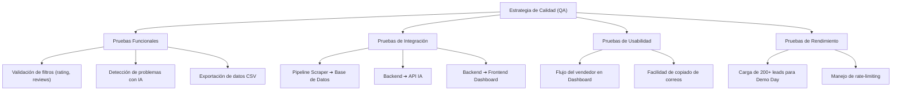

# Plan de Pruebas y Análisis Funcional — Radar de Reputación en Crisis

**Equipo:** S10-26-equipo-18  
**Proyecto:** Radar de Reputación en Crisis (Simulación Laboral Abierta — NoCountry)  
**Versión:** 1.0  
**Fecha:** Octubre 2026  
**Responsables del área QA:**
- Maria Chiribao (*QA Tester*)
- Dharo Gabriel Fernandez Carmona (*QA Engineer*)

---

## 1. Introducción y Propósito

El propósito de este documento es definir el marco funcional, los criterios de aceptación y los casos de prueba para el MVP de **Radar de Reputación en Crisis**. 
Este sistema automatiza la detección de negocios locales con crisis de reputación (1.5 a 3.5 estrellas), enriquece su información con IA y datos de contacto, y proporciona un dashboard para la gestión comercial y generación de propuestas B2B.

El objetivo del equipo de QA es asegurar que el pipeline de extracción, enriquecimiento y visualización cumpla con los estándares de calidad y soporte de forma confiable la meta del Demo Day (**al menos 200 leads reales**).

---

## 2. Alcance de las Pruebas

### 2.1 En Alcance (In Scope)
1. **Módulo de Extracción y Filtros:** Búsqueda por ciudad/rubro, filtrado por rating (1.5 - 3.5 estrellas), volumen (>10 reseñas) y deduplicación.
2. **Módulo de IA:** Extracción de reseñas negativas, clasificación del problema principal y generación de asunto + apertura de correo.
3. **Módulo de Enriquecimiento de Contacto:** Scraping de correo electrónico en la web del negocio y links de LinkedIn.
4. **Dashboard y Gestión:** Tabla de leads, filtros dinámicos, copia de pitch al portapapeles y exportación a CSV.
5. **No Funcionales:** Manejo de bloqueos/rate limits, timeouts en IA/scraping y consistencia de datos en base de datos.

### 2.2 Fuera de Alcance (Out of Scope para el MVP inicial)
- Envío automatizado masivo de correos (el MVP contempla la generación y copia manual del borrador).
- Integración directa con CRMs externos (HubSpot, Salesforce).
- Pagos o pasarelas de suscripción.

---

## 3. Matriz de Requisitos y Criterios de Aceptación (BDD / Gherkin)

### Épica 1: Motor de Extracción y Filtrado

#### US-01: Búsqueda parametrizada de negocios
- **Como** usuario comercial,
- **Quiero** ingresar una ciudad y un rubro comercial,
- **Para** obtener una lista de negocios que operen en dicha zona.

> **Criterio de Aceptación (AC-01.1):**
> **Dado** que el usuario ingresa una ciudad válida (ej. `Bogotá`) y un rubro (ej. `Clínicas dentales`),  
> **Cuando** se ejecuta la extracción,  
> **Entonces** el sistema debe consultar la fuente configurada y devolver los negocios correspondientes a esa ubicación y categoría.

#### US-02: Filtros de reputación y volumen
- **Como** usuario comercial,
- **Quiero** que el sistema descarte automáticamente negocios fuera del rango objetivo,
- **Para** enfocarme únicamente en leads con problemas de reputación reales y operando.

> **Criterio de Aceptación (AC-02.1):**
> **Dado** un conjunto de negocios extraídos,  
> **Cuando** se evalúa su calificación,  
> **Entonces** solo deben registrarse aquellos con calificación entre **1.5 y 3.5 estrellas** inclusive.

> **Criterio de Aceptación (AC-02.2):**
> **Dado** un negocio con calificación entre 1.5 y 3.5 estrellas,  
> **Cuando** se evalúa la cantidad total de reseñas,  
> **Entonces** solo debe aceptarse si cuenta con **más de 10 reseñas** (evitando negocios abandonados o con muestras insignificantes).

#### US-03: Deduplicación y actualización (*Upsert*)
- **Como** administrador de datos,
- **Quiero** evitar registros duplicados al ejecutar búsquedas repetidas,
- **Para** mantener una base de datos limpia y actualizada.

> **Criterio de Aceptación (AC-03.1):**
> **Dado** un negocio ya registrado en la base de datos (identificado por su `place_id` o ID único de fuente),  
> **Cuando** vuelve a aparecer en una nueva búsqueda,  
> **Entonces** el sistema debe actualizar sus métricas y fecha de última actualización sin duplicar el registro.

---

### Épica 2: Enriquecimiento mediante Inteligencia Artificial

#### US-04: Clasificación del problema principal
- **Como** vendedor de la agencia,
- **Quiero** que una IA analice las reseñas negativas recientes del negocio,
- **Para** conocer de inmediato cuál es su principal debilidad sin leer decenas de comentarios.

> **Criterio de Aceptación (AC-04.1):**
> **Dado** un negocio con reseñas negativas (1 a 3 estrellas),  
> **Cuando** se envían hasta 5 reseñas recientes al modelo de IA,  
> **Entonces** el sistema debe clasificar el problema en una categoría estandarizada (ej. `Mala atención al cliente`, `Precios elevados`, `Problemas de higiene`, `Demoras en el servicio`, `Otro`).

> **Criterio de Aceptación (AC-04.2):**
> **Dado** un error de conexión o timeout con el proveedor de IA,  
> **Cuando** falla el procesamiento,  
> **Entonces** el lead debe guardarse con estado `Pendiente de análisis` sin interrumpir la extracción general.

#### US-05: Redacción de borrador comercial personalizado
- **Como** vendedor de la agencia,
- **Quiero** un asunto y primer párrafo de correo redactado con base en las quejas detectadas,
- **Para** contactar al lead con un mensaje altamente personalizado y empático.

> **Criterio de Aceptación (AC-05.1):**
> **Dado** un negocio analizado con una queja principal detectada,  
> **Cuando** se solicita el borrador comercial,  
> **Entonces** la IA genera:
> 1. Un asunto persuasivo que mencione el dolor del negocio.
> 2. Un párrafo introductorio que mencione el rubro y la oportunidad de mejora sin sonar acusatorio.

---

### Épica 3: Enriquecimiento de Datos de Contacto

#### US-06: Extracción de correo electrónico web
- **Como** usuario comercial,
- **Quiero** que el sistema extraiga correos electrónicos del sitio web del negocio,
- **Para** poder contactar a los tomadores de decisión.

> **Criterio de Aceptación (AC-06.1):**
> **Dado** que un negocio dispone de URL de sitio web,  
> **Cuando** el pipeline visita la página de inicio o `/contacto`,  
> **Entonces** debe extraer direcciones de correo válidas descartando formatos estáticos inválidos (ej. archivos de imagen o ejemplos tipo `info@domain.com`).

#### US-07: Información de LinkedIn
- **Como** usuario comercial,
- **Quiero** encontrar enlaces o perfiles de LinkedIn asociados a la empresa,
- **Para** realizar prospección multicanal.

---

### Épica 4: Dashboard de Prospección y Usabilidad

#### US-08: Visualización y filtrado de leads
- **Como** usuario de ventas,
- **Quiero** ver una tabla con los leads calificados y poder filtrarlos,
- **Para** priorizar los contactos según mis objetivos diarios.

> **Criterio de Aceptación (AC-08.1):**
> **Dado** que el usuario ingresa al Dashboard,  
> **Cuando** aplica filtros por `Ciudad`, `Problema detectado`, `Rango de calificación` o `Estado`,  
> **Entonces** la tabla debe actualizar los resultados de inmediato sin recargar toda la página.

#### US-09: Exportación a CSV
- **Como** usuario de ventas,
- **Quiero** exportar la lista de leads a un archivo CSV,
- **Para** compartirlo con el equipo o importarlo en herramientas externas.

> **Criterio de Aceptación (AC-09.1):**
> **Dado** un conjunto de leads filtrados o totales,  
> **Cuando** el usuario presiona "Exportar CSV",  
> **Entonces** se descarga un archivo CSV con codificación UTF-8 que incluye todos los campos (Nombre, Teléfono, Email, Rating, Problema, etc.) sin caracteres corruptos.

#### US-10: Copia de borrador de correo
- **Como** vendedor,
- **Quiero** un botón de un clic para copiar el borrador de correo generado,
- **Para** pegarlo directamente en mi cliente de correo o CRM.

> **Criterio de Aceptación (AC-10.1):**
> **Dado** que el usuario visualiza el detalle de un lead,  
> **Cuando** hace clic en "Copiar borrador",  
> **Entonces** el texto completo del asunto y cuerpo se copia al portapapeles y se muestra una notificación visual de confirmación (*Toast*).

---

## 4. Matriz Detallada de Casos de Prueba (Test Cases)

| ID | Módulo | Caso de Prueba | Precondiciones | Pasos | Resultado Esperado | Prioridad |
|---|---|---|---|---|---|---|
| **TC-EXT-01** | Extracción | Búsqueda con parámetros válidos | API/Scraper online | Enviar ciudad `Bogotá` y rubro `Restaurantes`. | Devuelve lista de negocios en Bogotá. | Alta |
| **TC-EXT-02** | Extracción | Filtro de calificación máxima | Búsqueda iniciada | Probar con negocios de 3.6 a 5.0 estrellas. | Negocios con rating > 3.5 son descartados. | Alta |
| **TC-EXT-03** | Extracción | Filtro de calificación mínima | Búsqueda iniciada | Probar con negocios de 0.0 a 1.4 estrellas. | Negocios con rating < 1.5 son descartados. | Alta |
| **TC-EXT-04** | Extracción | Filtro de volumen de reseñas | Búsqueda iniciada | Negocio con 8 reseñas y 2.5 estrellas. | Se descarta por tener ≤ 10 reseñas. | Alta |
| **TC-EXT-05** | Extracción | Negocio en rango objetivo | Búsqueda iniciada | Negocio con 25 reseñas y 2.8 estrellas. | Es aceptado y guardado como lead potencial. | Alta |
| **TC-EXT-06** | Extracción | Deduplicación de negocios | Negocio X ya en BD | Ejecutar misma búsqueda que contiene Negocio X. | Se actualiza registro existente; no se duplica. | Alta |
| **TC-EXT-07** | Extracción | Resiliencia ante bloqueos (429/Captcha) | Entorno de red real | Simular múltiples peticiones consecutivas. | El extractor aplica backoff / reintentos sin caer en crash. | Media |
| **TC-IA-01** | IA | Clasificación de problema con 5 reseñas | 5 reseñas negativas | Enviar texto de quejas sobre demora y esperas. | Clasifica como `Demoras en el servicio`. | Alta |
| **TC-IA-02** | IA | Generación de asunto y apertura | Lead analizado | Solicitar draft de correo para lead clasificado. | Genera texto coherente, profesional y sin acusaciones agresivas. | Alta |
| **TC-IA-03** | IA | Manejo de fallback por fallo de IA | API Key inválida o sin red | Ejecutar pipeline con servicio de IA apagado. | Lead se guarda; estado queda `Pendiente IA`, loggea error. | Media |
| **TC-IA-04** | IA | Negocio con reseñas vacías o ambiguas | Lead con reseñas sin texto | Enviar reseñas que solo tienen estrellas sin texto. | Clasifica como `General / Sin detalle` sin generar error. | Media |
| **TC-CNT-01** | Contacto | Scraping de email en sitio web | Negocio con web operativa | Extraer de `contacto.html` con email visible. | Captura email en formato regex válido. | Alta |
| **TC-CNT-02** | Contacto | Web inexistente o caída | Negocio con URL 404 o timeout | Intentar enriquecer contacto. | Registra email como `No disponible` sin trabar el pipeline. | Alta |
| **TC-CNT-03** | Contacto | Enlace o mención de LinkedIn | Web con footer de redes | Analizar enlaces de la página. | Detecta enlace a perfil de LinkedIn de la empresa. | Media |
| **TC-DASH-01**| Dashboard | Renderizado de leads en tabla | 10+ leads en BD | Cargar vista principal del dashboard. | Muestra columnas: Nombre, Ciudad, Rating, Reseñas, Problema, Contacto. | Alta |
| **TC-DASH-02**| Dashboard | Filtro por problema detectado | Leads con varios problemas | Seleccionar filtro `Mala atención al cliente`. | Solo lista leads con esa etiqueta. | Alta |
| **TC-DASH-03**| Dashboard | Filtro por rango de calificación | Leads de 1.5 a 3.5 | Filtrar entre 2.0 y 2.5 estrellas. | Solo lista leads en dicho rango. | Alta |
| **TC-DASH-04**| Dashboard | Exportación a CSV | Leads en tabla | Clic en botón "Exportar CSV". | Descarga archivo `.csv`, codificación UTF-8, legible en Excel. | Alta |
| **TC-DASH-05**| Dashboard | Copiado rápido de borrador | Lead seleccionado | Clic en "Copiar borrador". | Copia contenido al portapapeles y notifica éxito con toast. | Media |
| **TC-DASH-06**| Dashboard | Responsividad y navegación | Pantallas Desktop y Tablet | Probar diferentes resoluciones. | La tabla y filtros se adaptan correctamente. | Baja |
| **TC-VOL-01** | Volumen | Capacidad para 200+ leads | Base para Demo Day | Cargar lote de 200 leads reales. | El dashboard y BD responden en < 2 segundos. | Alta |

---

## 5. Estrategia y Tipos de Pruebas

1. **Pruebas Unitarias & Integración:**
   - Pruebas del backend en lógica de filtrado y deduplicación (Pytest o Jest).
   - Mocking de APIs externas de mapas e IA para pruebas continuas sin gastar cuota.
2. **Pruebas de Extracción (Scraping):**
   - Validar selectores o parsers frente a variaciones de formato de las plataformas fuente.
3. **Pruebas Manuales / Exploratorias:**
   - Verificación de la coherencia del texto generado por la IA en español neutro y formal.
   - Verificación de la usabilidad del dashboard desde el rol del vendedor.

---

## 6. Criterios de Aceptación para el Demo Day

Para considerar el MVP listo para la presentación:
- [ ] Pipeline probado con al menos 2 combinaciones de ciudad/rubro (ej. *Restaurantes en CDMX*, *Clínicas dentales en Bogotá*).
- [ ] Base de datos con al menos **200 leads reales y verificables**.
- [ ] 100% de los leads cumplen con el filtro de 1.5 a 3.5 estrellas y >10 reseñas.
- [ ] Etiquetas de problemas generadas por IA coherentes con las reseñas reales.
- [ ] Funcionalidad de exportar a CSV y copiar plantilla de email 100% operativa en el frontend.
